# femtovg: comparison images for eight bugs

The [text frame benchmark](#the-text-frame-benchmark) measures the cost of drawing a Slint-like
frame of text, labels or a scrolling table, on no renderer, OpenGL and WGPU, before and after a
change that splits out color glyphs only when a glyph run is drawn as outlines.

The [portable profiling harness](profiling/README.md) compares CPU work for the
direct-text gradient fix (#389), with draw/flush timing, allocation accounting,
macOS Instruments capture, and a Linux `perf` collector.

The programs that made the comparison images for four pull requests to
[femtovg](https://github.com/femtovg/femtovg), for one fix that is not a pull request yet, and
for three more bugs that have no fix yet. In each image for a pull request or a fix, the left half
is a scene built against upstream master and the right half is the same scene built against the
commit of its pull request or fix. Both halves are drawn at device pixel ratio 1 and nothing is
rescaled.

The first pull request, [femtovg/femtovg#384](https://github.com/femtovg/femtovg/pull/384),
fixes the glyph-mask bug: with the `swash` feature, filled text at a negative x is drawn with
the wrong glyph mask. Left: upstream master at
[`eb4fe53`](https://github.com/femtovg/femtovg/commit/eb4fe53d51a6a274754a787a55179140bc7d6c77).
The typeface, the font size and the content of its two scenes were chosen by a search to make
the effect as large as possible (see below).

An About panel, Roboto Flex 10 px:

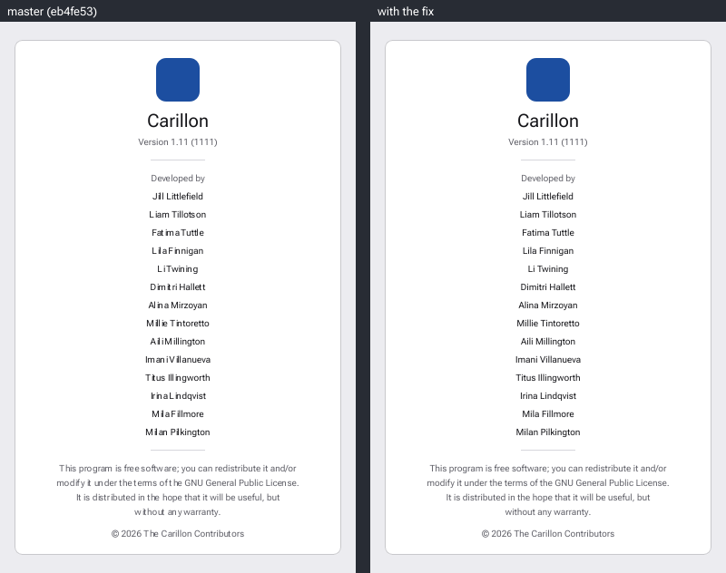

A menu card, New York 12 px (the top 680 px of a 912 px render):

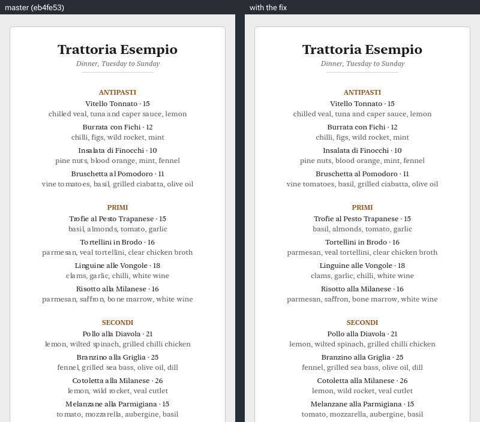

The second pull request fixes the letter-spacing bug: text at a negative letter spacing gets the
width that the same text, in the same font and font size, had at the letter spacing it was first
shaped with, when that was 0 or negative. The gaps between its glyphs are right; only the width
is wrong. Left: upstream master at
[`485c665`](https://github.com/femtovg/femtovg/commit/485c66566bac9b4a580d2afb8d8230122d6f8457).
The alignment, the sentence, the letter spacings and the order of the lines were chosen by hand
to make the effect large (see below).

A letter-spacing specimen, Roboto Flex 28 px. Every line is drawn with `Align::Right` at the
same x, which is 4 px left of the red rule:

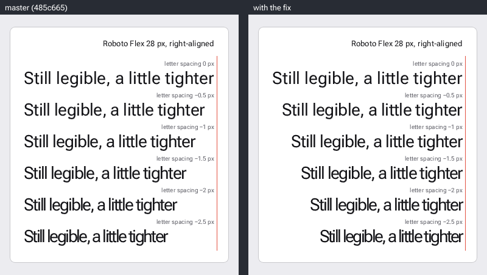

The third pull request fixes the gradient bug. When femtovg draws the glyphs of a text as
outlines, a gradient or image paint is applied to each glyph separately, so a gradient starts
again in every letter. The left half is upstream master at
[`6dd5543`](https://github.com/femtovg/femtovg/commit/6dd55434177690c845fc5e6f8e9d5a2fe6f1b277).
The font sizes and the gradients were chosen by hand (see below).

Two lines with one gradient across the canvas, Roboto Flex. The top line is 90 px and comes from
the glyph atlas. The bottom line is 100 px and is drawn as outlines.

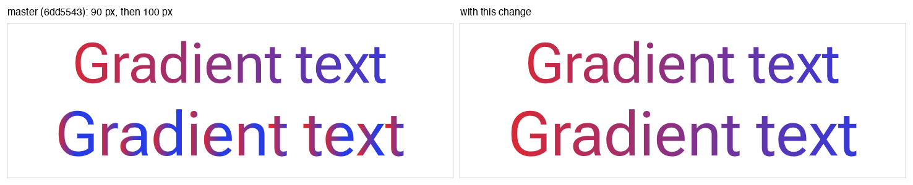

One 100 px line with a gradient that goes from opaque to transparent, under a blurred shadow.

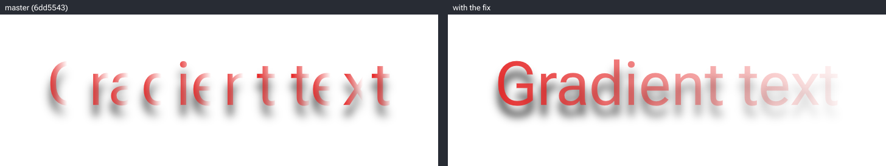

The fourth bug is the glyph-run shadow bug. With a canvas shadow set, `fill_text` casts one
shadow for the whole text, and `fill_glyph_run` casts one for every glyph that it draws as an
outline. The shadow of a glyph is drawn after the glyphs before it, and covers them where it
reaches them. Both halves of the image are upstream master at
[`d70ffeb`](https://github.com/femtovg/femtovg/commit/d70ffeb79658606fe220801115ccefff33897e86).
The upper half is drawn with `fill_text` and the lower half with `fill_glyph_run`. The words, the
letter spacing, the colours and the shadow were chosen by hand (see below).

Two 100 px lines, Roboto Flex, under a shadow that is 14 px left of the text and 8 px below it:

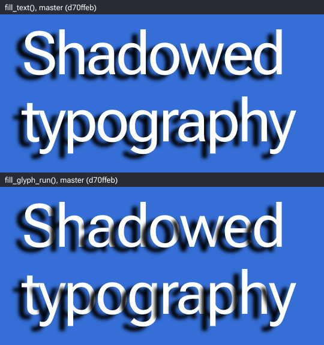

The fifth bug is the shadow cut-off bug. The shadow of a stroke is cut off where a miter join
or a square cap reaches more than half the line width past the bounding box of the path's
points. Every render is upstream master at
[`d70ffeb`](https://github.com/femtovg/femtovg/commit/d70ffeb79658606fe220801115ccefff33897e86).
One render of each scene sets no canvas shadow and draws the stroke twice, the first time in
black where the shadow belongs. The other draws the stroke once under a canvas shadow that has
no blur. The two should be the same. The shapes, the line widths and the shadow were chosen by
hand (see below).

The outline of a square with miter joins, upright and turned by 45 degrees:

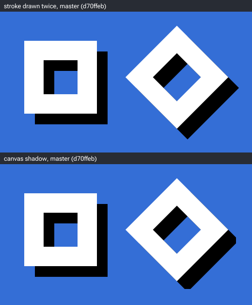

A line with square caps, level and turned by 45 degrees:

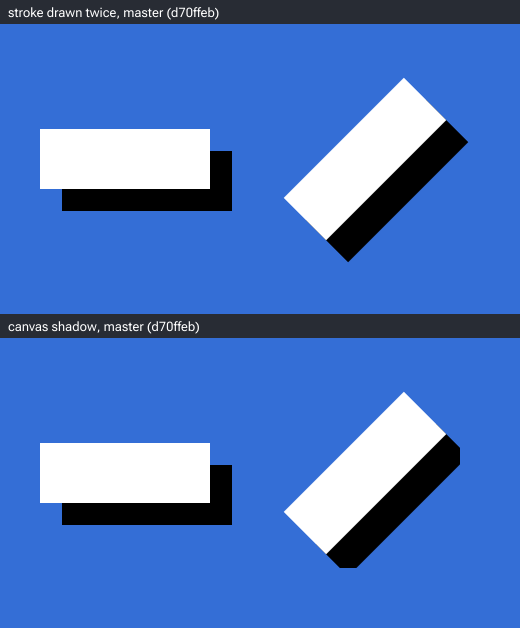

The outline of a five-pointed star with miter joins:

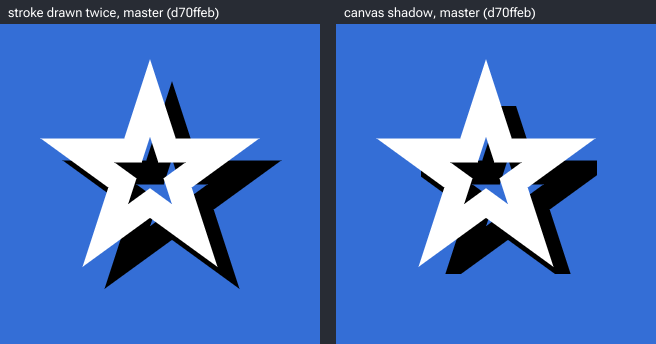

The sixth bug is the path-cache bug, and the fourth pull request fixes it. A `Path` that is
drawn or hit-tested, then extended with more verbs, then drawn again under the same transform
is drawn as it was at its first draw. Left: upstream master at
[`8d092f2`](https://github.com/femtovg/femtovg/commit/8d092f2807d5f81eb8dbaa73d01e65b7e7dbde1d).
Both scenes keep one path, append to it every frame, draw it every frame and keep the last
frame. The curve, the bars and the markers were chosen by hand (see below).

A trace that gets one sample per frame and is stroked every frame. The dot and the line down
the canvas mark the newest sample:

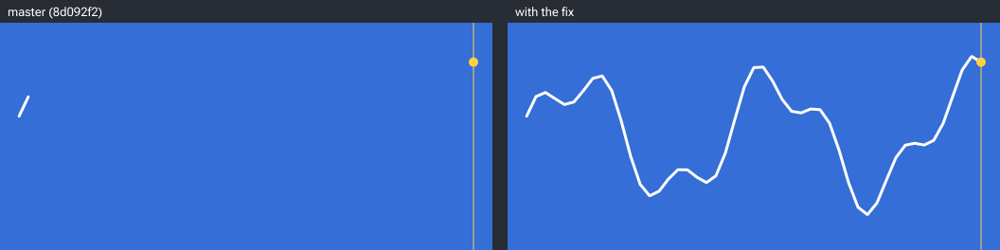

A bar chart that gets one bar per frame and is filled every frame. The dot marks the newest
bar:

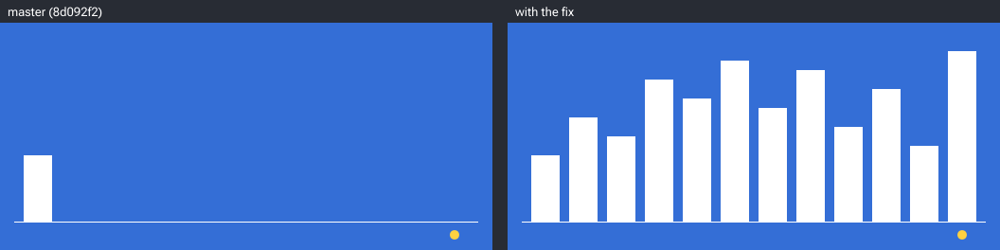

The seventh bug is the shaping-key bug. The key of femtovg's shaping caches rounds the font size
to a tenth of a pixel and the width that text is wrapped at to a whole pixel, while shaping reads
both exactly. So text at two font sizes in one tenth of a pixel shares one cache entry, and so
does text wrapped at two widths in one whole pixel, and a call gets what an earlier call
computed until the entry leaves the cache. The fix is not a pull request yet. Left: upstream
master at
[`8d092f2`](https://github.com/femtovg/femtovg/commit/8d092f2807d5f81eb8dbaa73d01e65b7e7dbde1d).
Both scenes lay a box out from one call and paint its text from a later one, after 1100 other
strings were shaped. The sentence, the font sizes, the paragraph and the box widths were chosen
by hand (see below).

One sentence at 10 px, then at 10.09 px in a cell as wide as it measured, Roboto Flex:

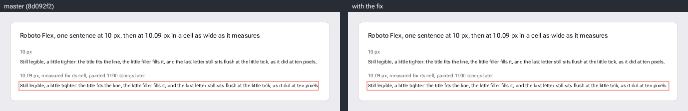

One paragraph in two boxes, the second 0.2 px narrower, each with a button below it, Roboto
Flex 13 px:

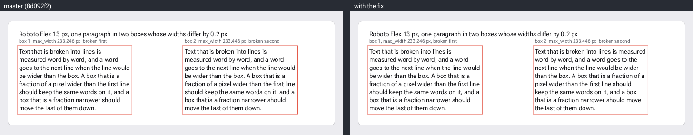

The eighth bug is the CBDT gap bug, which has no fix yet. A CBDT color bitmap font can mark a
glyph in a range of bitmaps as having none, and femtovg then draws the next glyph's bitmap in its
place, with and without the `swash` feature. Both renders are upstream master at
[`9f5ad26`](https://github.com/femtovg/femtovg/commit/9f5ad2614e922677a467e2d6f66fecba14d3a30a),
the upper with femtovg's default features and the lower with `swash` alone. The scene builds its
own font by hand (see below).

Glyph 1, a triangle with no bitmap, and glyph 2, a red bitmap, drawn with `fill_glyph_run`, then
glyph 1's outline drawn with `fill_path`. The first and the third should be the same:

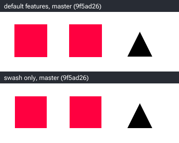

`images/` also has each whole render, and a 4x enlargement of part of the About panel, of the
menu card, of the shadow scene and of the size scene.

## The glyph-mask bug

With the `swash` cargo feature, femtovg rasterizes a filled glyph into a coverage bitmap (a
mask), keeps it in the glyph atlas and reuses it. It keeps one mask per tenth of a pixel of the
fraction of the glyph's x. `GlyphAtlas::render_atlas` in `src/text.rs` computes that tenth as
`quantize(glyph.x.fract(), 0.1) * 10.0` and casts it to `u8` for the cache key. For a negative
x the value is zero or negative, and the cast gives 0. So every negative x of a glyph shares
one cache entry with the glyph's whole-pixel positions, and the glyph is drawn with whichever
mask was rasterized first, up to 1 px from its place. Neighbouring glyphs get different errors,
so the gap between two letters can be wrong by almost 2 px.

`glyph.x` does not include the canvas translation. The About panel and the menu card draw every
line like this, which gives the left half of the line a negative x:

```rust
canvas.save();
canvas.translate(cx, baseline);
canvas.fill_text(0.0, 0.0, text, &paint)?; // paint has Align::Center
canvas.restore();
```

### What was chosen to make the effect large

[`search/about_names.py`](search/about_names.py) chose the 14 names and their order.
[`search/menu_climb.py`](search/menu_climb.py) chose which dishes each course lists, their
order, each price within 2 of a base price, and the order of the ingredients. Of the typefaces
and sizes tried, the one with the most wrong gaps was kept for each scene.

The search does not make any single error larger. It raises the number of neighbouring glyphs
that get different errors:

| gaps between neighbouring glyphs wrong by 1 px or more | searched | 1000 random choices: mean (range) |
| ------------------------------------------------------ | -------- | --------------------------------- |
| About panel (398 gaps)                                 | 78       | 17.6 (6 to 36)                    |
| Menu card (897 gaps)                                   | 119      | 32.9 (10 to 70)                   |

[`src/replay.rs`](src/replay.rs) computes these counts from the glyph positions that
`fill_text` returned. They are not measured from pixels. The random choices were counted, not
rendered.

## The letter-spacing bug

This bug does not need the `swash` feature. It is in the `textlayout` feature, which is on by
default, and the specimen is built without `swash`.

femtovg caches shaped text. `shape` in `src/text/textlayout.rs` keeps the `TextMetrics` of a
whole string in `shaping_run_cache`, and `shape_run` keeps every word of it in
`shaped_words_cache`. The key of both caches is a `ShapingId`. `ShapingId::new` computes its
field `letter_spacing_key` as `(letter_spacing * 10.0).trunc() as u32`, and the cast gives 0 for
a negative value. So every negative letter spacing has the key 0, which is also the key of
letter spacing 0, and the same text in the same font and font size shares one cache entry at
all of them.

A cache entry holds the advance of each glyph without the letter spacing, and a width that
includes it: `shape_word` adds `advance_x + letter_spacing` to `ShapedWord::width` for every
glyph. `layout` computes the glyph positions on every call, from the advances and the letter
spacing of that call. So text that is found in the cache gets the right gaps between its glyphs,
and the width that it had at the letter spacing it was first shaped with. That width is what
`TextMetrics::width()` returns, and what `layout` subtracts from x for `Align::Right`. For
`Align::Center` it subtracts half.

The specimen draws one sentence six times, at letter spacing 0 first and then at -0.5, -1, -1.5,
-2 and -2.5 px:

```rust
let paint = sample.clone().with_letter_spacing(letter_spacing); // sample has Align::Right
canvas.fill_text(RIGHT, baseline, SAMPLE, &paint)?;
```

On master the five lines with a negative letter spacing get the cache entry of the first line.
All six start at the same x, and a line with a more negative letter spacing ends further left
of `RIGHT`. With the fix every line ends at `RIGHT`.

Here a line ends where `layout` leaves its cursor after the last glyph. `layout` moves the
cursor by the advance of a glyph plus the letter spacing, so with a negative letter spacing the
advance of the last glyph ends right of the end of the line by the size of the letter spacing,
up to 2.5 px. That is why the red rule is 4 px right of `RIGHT` and not at `RIGHT`.

### What was chosen to make the width error large

Nothing was searched for. The error of a line is the number of its glyphs times the difference
between its letter spacing and the letter spacing that the cached width was computed with. These
were chosen by hand:

- `Align::Right`, because `layout` then subtracts the whole width from x, so the line is drawn
  left of its place by the whole error of the width. With `Align::Center` it would be half.
- The same sentence on every line, with the line at letter spacing 0 first. Every later line
  finds the `TextMetrics` of the first line in `shaping_run_cache`, so its width is the width at
  letter spacing 0, which is too large by the letter spacing of all 31 glyphs, spaces included.
- A sentence of 31 glyphs, "Still legible, a little tighter". It has many narrow letters (i, l
  and t), so the 31 glyphs are 312.32 px wide at letter spacing 0 and fit on one line of the
  card.
- Letter spacings down to -2.5 px at a font size of 28 px. In the tightest lines neighbouring
  letters touch, which is tighter than text is normally set.

| letter spacing | glyphs | `TextMetrics::width()` on master | with the fix | on master the line ends left of `RIGHT` by |
| -------------- | ------ | -------------------------------- | ------------ | ------------------------------------------ |
| 0 px           | 31     | 312.32 px                        | 312.32 px    | 0 px                                       |
| -0.5 px        | 31     | 312.32 px                        | 296.82 px    | 15.5 px                                    |
| -1 px          | 31     | 312.32 px                        | 281.32 px    | 31 px                                      |
| -1.5 px        | 31     | 312.32 px                        | 265.82 px    | 46.5 px                                    |
| -2 px          | 31     | 312.32 px                        | 250.32 px    | 62 px                                      |
| -2.5 px        | 31     | 312.32 px                        | 234.82 px    | 77.5 px                                    |

On master the last column adds up to 232.5 px and its largest value is 77.5 px. With the fix
every value in it is 0 px. [`src/spacing.rs`](src/spacing.rs) computes these numbers from the
`TextMetrics` that `fill_text` returned, on both revisions. They are not measured from pixels.
[`images/spacing-summary.txt`](images/spacing-summary.txt) has all of them.

## The gradient bug

This bug does not need the `swash` feature either, and the two scenes are built without it.

femtovg draws a glyph from the glyph atlas or as an outline. `draw_glyph_run` in `src/lib.rs`
chooses the outline for text larger than 92 px, and for text with a gradient or image paint
under a scale, rotation, skew or flip. `render_direct` in `src/text.rs` then fills or strokes
the outline of each glyph as a path.

On master `render_direct` places each glyph by changing the canvas transform. For every glyph it
calls `save()`, `translate()` and `scale()`, draws the outline, and calls `restore()`. The
canvas transform also maps the coordinates of the paint. So the paint is mapped again for every
glyph, in that glyph's font units and from that glyph's origin, and each letter gets its own
small copy of the gradient. With the fix `render_direct` does not change the canvas transform.
It passes the glyph's placement along with the outline, and the paint is mapped by the canvas
transform as for any other shape.

The first scene draws the same words twice with one paint.

```rust
let paint = Paint::linear_gradient(40.0, 0.0, 680.0, 0.0, red, blue); // and the font and alignment
canvas.fill_text(360.0, 65.0, "Gradient text", &paint.clone().with_font_size(90.0))?;
canvas.fill_text(360.0, 180.0, "Gradient text", &paint.with_font_size(100.0))?;
```

The 90 px line comes from the glyph atlas and is the same on both revisions. The 100 px line is
drawn as outlines. On master every letter of it has its own gradient. With the fix the gradient
runs across the line, as it does in the line above.

The second scene shows the same fault in a shadow. femtovg builds a shadow by drawing the text a
second time into an offscreen image and giving the result the shadow colour, so a shadow has
the alpha of what was drawn. It is wrong only when the alpha of the paint varies. In this scene
the gradient goes from opaque red to transparent red.

```rust
let paint = Paint::linear_gradient(40.0, 0.0, 680.0, 0.0, red, transparent_red); // and the font, 100 px
canvas.set_shadow_color(Color::black());
canvas.set_shadow_offset(0.0, 18.0);
canvas.set_shadow_blur(14.0);
canvas.fill_text(360.0, 115.0, "Gradient text", &paint)?;
```

On master the text fades inside every letter, and every letter has its own patch of shadow. With
the fix the text and its shadow both fade once, from the left end of the line to the right end.

### What was chosen to make the effect easy to see

Nothing was searched for. These were chosen by hand:

- Font sizes of 90 px and 100 px, one on each side of the 92 px limit. One picture then shows
  text from the glyph atlas and text drawn as outlines with the same paint.
- A gradient that spans the canvas, so that the 90 px line shows what the 100 px line should
  look like.
- A gradient to transparent in the shadow scene, because a shadow takes only its alpha from the
  paint.
- A shadow that is 18 px below the text and blurred by 14 px. It stays visible under the
  letters and looks like a shadow.

[`src/gradient.rs`](src/gradient.rs) draws both scenes. It prints nothing, so
[`images/gradient-text-summary.txt`](images/gradient-text-summary.txt) and
[`images/gradient-shadow-summary.txt`](images/gradient-shadow-summary.txt) have only the number
of pixels in which the two revisions differ.

## The glyph-run shadow bug

This bug does not need the `swash` feature either, and the scene is built without it.

Three functions in femtovg's `src/lib.rs` cast a canvas shadow: `fill_path_internal`,
`stroke_path_internal` and `draw_text`. `fill_text` and `stroke_text` call `draw_text`, which
casts one shadow for the whole text and turns the shadow off while it draws the glyphs.
`fill_glyph_run` and `stroke_glyph_run` call `draw_glyph_run` directly, and `draw_glyph_run` has
no shadow code. It draws text larger than 92 px as outlines: `render_direct` in `src/text.rs`
fills or strokes the outline of each glyph with `fill_path_internal` or `stroke_path_internal`,
and each of those calls casts a shadow. So a glyph run is drawn as shadow, glyph, shadow, glyph,
and the shadow of a glyph lies over the glyphs that were drawn before it.

A glyph run that is drawn from the glyph atlas casts no shadow at all. This scene does not show
that.

The scene draws each of its two lines with one call. The upper half of the image uses
`fill_text`. The lower half asks `measure_text` for the glyphs of the line and passes them to
`fill_glyph_run`, so both halves draw every glyph at the same place.

```rust
canvas.set_shadow_color(Color::black());
canvas.set_shadow_offset(-14.0, 8.0);
canvas.set_shadow_blur(6.0);

// The upper half.
canvas.fill_text(36.0, baseline, line, &paint)?;

// The lower half. `glyphs` has the glyph ids and positions that measure_text returned.
canvas.fill_glyph_run(font, &[], glyphs, &paint)?;
```

Without the shadow the two halves are the same in every pixel. With it, `fill_text` leaves every
letter white, and `fill_glyph_run` darkens the right side of a letter with the shadow of the
next one. The a, the d and the o of the first line, enlarged 4 times:

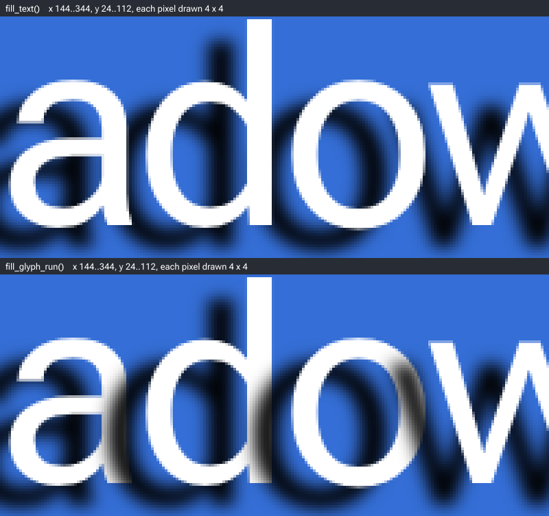

### What was chosen to make the effect easy to see

Nothing was searched for. These were chosen by hand:

- A shadow to the left of the text. A line is drawn from left to right, so a shadow to the left
  lands on letters that are already drawn. A shadow to the right lands where the next letter is
  drawn afterwards, and that letter covers it.
- A font size of 100 px, above the 92 px limit, so that every glyph is drawn as an outline.
- A letter spacing of -4 px. The closer two letters are, the more of the left one the shadow of
  the right one covers. This is tighter than the font's own spacing, and some letters almost
  touch.
- Words with many round letters (a, d, e, g, o and p). A round side comes closer to the next
  letter than a straight stem does.
- White text on blue under a black shadow, so that the shadow shows on the background and on a
  letter.
- Two lines, to show more pairs of letters. Each line is drawn with its own call in both halves,
  and the shadow of the first line does not reach the second.

[`src/shadow.rs`](src/shadow.rs) draws the scene.
[`images/shadow-summary.txt`](images/shadow-summary.txt) has the number of pixels in which
`fill_text` and `fill_glyph_run` differ, without the shadow and with it.

## The shadow cut-off bug

This bug is not specific to text, and the scenes draw none.

femtovg makes a shadow by drawing the shape a second time into an offscreen image, and it sets
the size of that image before it draws. For a stroke, `stroke_path_internal` in `src/lib.rs`
takes the bounding box of the path's points and grows it by half the line width on each side.
A stroke can reach further than that in two places. A miter join reaches half the line width
divided by the sine of half the angle between its two edges, measured from the corner. A corner
of a square cap is 1.41 times half the line width from the end of the line. The part of the
stroke that is outside the image has no shadow.

At a right angle a miter reaches 1.41 times half the line width from the corner, the same as
the corner of a square cap. For a corner on the edge of the bounding box, whether that is
outside the image depends on its direction. With one edge along x and the other along y, it is
half the line width along x and half along y, so it is inside and the shadow is whole. Turned
by 45 degrees, it is 1.41 times half the line width along one of the two, so the tip is
outside. A miter sharper than a right angle reaches further still.

The first two scenes show this with one shape drawn twice: upright on the left, where the
shadow is whole, and turned by 45 degrees on the right, where its corners are cut off. The Web
Platform Tests for Canvas shadows have the upright shapes only:
[`2d.shadow.stroke.join.2`](https://github.com/web-platform-tests/wpt/blob/master/html/canvas/element/shadows/2d.shadow.stroke.join.2.html)
draws a right-angle join with one edge along x and the other 1 degree from y, and
[`2d.shadow.stroke.cap.2`](https://github.com/web-platform-tests/wpt/blob/master/html/canvas/element/shadows/2d.shadow.stroke.cap.2.html)
draws a square cap on a level line.

Each scene is drawn two ways:

```rust
// "stroke drawn twice": no canvas shadow.
canvas.translate(22.0, 22.0);
canvas.stroke_path(&path, &black);
canvas.reset_transform();
canvas.stroke_path(&path, &white);

// "canvas shadow"
canvas.set_shadow_color(Color::black());
canvas.set_shadow_offset(22.0, 22.0);
canvas.set_shadow_blur(0.0);
canvas.stroke_path(&path, &white);
```

### What was chosen to make the effect easy to see

Nothing was searched for. These were chosen by hand:

- A shadow with no blur. It is then the shape of the stroke, moved by the offset, and the
  stroke drawn a second time shows what it should be.
- An offset of 22 px to the right and 22 px down, so that the corners on the right of a shape
  and below it are not hidden behind the stroke.
- Lines of 24 px to 60 px. The part that is cut off grows with the line width.
- A star, because its points are 36 degrees. Its miters reach 3.2 times half the line width,
  so more is cut off than at a right angle.

[`src/cutoff.rs`](src/cutoff.rs) draws the scenes. `images/cutoff-joins-summary.txt`,
`images/cutoff-caps-summary.txt` and `images/cutoff-star-summary.txt` have the number of pixels
in which the two renders of a scene differ.

## The path-cache bug

This bug is not specific to text either, and the scenes draw none.

A `Path` keeps one flattened, transformed copy of itself, so that a path drawn every frame
under the same transform is not flattened again each frame. `Path::cache` in femtovg's
`src/path.rs` builds the copy the first time the path is drawn or hit-tested, keyed on the
canvas transform, and rebuilds it only when the transform changes. `Path::append`, which every
builder method (`move_to`, `line_to`, `rect`, `circle` and the rest) calls to add its verbs,
does not drop the copy. So the next draw under the same transform draws the copy, which has
the verbs the path had when it was first drawn. `fill_path`, `stroke_path`, `contains_point`,
`path_bbox` and `clip_path` all read it. The fix drops the copy in `Path::append`.

Both scenes keep one `Path` for the whole run, append to it every frame and draw it every
frame, with no canvas transform. The trace does this:

```rust
let mut path = Path::new();
path.move_to(samples[0].0, samples[0].1);
for &sample in &samples[1..] {
    path.line_to(sample.0, sample.1);
    canvas.clear_rect(0, 0, WIDTH, HEIGHT, BACKGROUND);
    canvas.stroke_path(&path, &paint);
    // The marker, from a new Path; then the frame is flushed.
}
```

On master the first frame flattens the path with its first segment, and every later frame
strokes that. The trace stops at its first segment while the marker is at the 49th sample,
and the bar chart has its first bar while the marker is under the twelfth. With the fix the
trace has all 48 segments and the chart all twelve bars.

### What was chosen to make the effect easy to see

Nothing was searched for. These were chosen by hand:

- One path that grows by one verb per frame and is drawn every frame, the way an app that
  plots live data or records a pen stroke draws. Every frame is flushed.
- The first draw after the first segment and after the first bar, so that master draws
  something and the picture shows where the drawing stopped, not an empty canvas.
- A marker at the newest sample or bar, drawn from a new `Path` every frame. A new path has no
  copy to draw from, so the marker is right on both revisions and shows how far the drawing
  should have come.
- A trace with two harmonics and twelve bars of different heights, so that the whole drawing
  is plainly more than its first segment or bar.
- A stroke in one scene and a fill in the other, because both read the copy.

[`src/pathcache.rs`](src/pathcache.rs) draws both scenes. It prints nothing, so
`images/pathcache-trace-summary.txt` and `images/pathcache-bars-summary.txt` have only the
number of pixels in which the two revisions differ.

## The shaping-key bug

This bug does not need the `swash` feature either, and the scenes are built without it.

femtovg caches shaped text. `shape` in `src/text/textlayout.rs` keeps the `TextMetrics` of a
whole string in `shaping_run_cache`, and `shape_run` keeps every word of it in
`shaped_words_cache`. The key of both caches is a `ShapingId`, and besides the letter spacing
`ShapingId::new` rounds two of its inputs: the font size to a tenth of a pixel, as
`(font_size * 10.0).trunc() as u32`, and the width that `break_text` and `break_text_vec` wrap at
to a whole pixel, as `max_width.trunc() as i32`. Shaping reads both exactly: `shape_word` scales
every advance by `font_size / units_per_em`, and `shape_run` moves a word to the next line when
the width of the line plus the width of the word reaches `max_width`. So the same text at two
font sizes in one tenth of a pixel shares one cache entry, and so does the same text wrapped at
two widths in one whole pixel. The entry holds what the first call computed. The fix keys both
with `to_bits()`.

Both caches are LRU caches of 1000 entries. So a call gets the first call's result until 1000
other strings have been shaped, and computes its own after that. An application lays a box out
from one call and paints its text from another, and the two can fall on either side of that.
Both scenes do that: they lay out, shape 1100 other strings, and paint.

The `size` scene draws one sentence at 10 px, then measures it at 10.09 px for the width of its
cell, and paints it at 10.09 px after the other strings:

```rust
canvas.fill_text(LEFT, first_baseline, SENTENCE, &at_10_px)?;
let cell = canvas.measure_text(LEFT, baseline, SENTENCE, &at_10_09_px)?.width();
// The cell border is drawn from `cell`; then 1100 other strings are shaped.
canvas.fill_text(LEFT, baseline, SENTENCE, &at_10_09_px)?;
```

On master the measurement gets the entry of the 10 px line, 595.449 px, and the paint computes
the line at 10.09 px, 600.808 px, so the text runs 5.359 px past the cell it was measured for.
With the fix both are 600.808 px. The right end of the cell, enlarged 4 times:

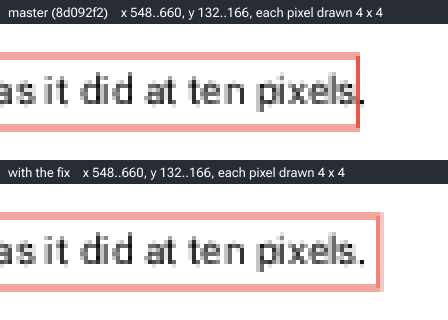

The glyph atlas has its own key, `RenderedGlyphId` in `src/text.rs`, which still rounds the font
size to a tenth of a pixel, and the fix does not change it, so the 10.09 px line is drawn with
the 10 px bitmaps on both revisions. Only the advances differ.

The `wrap` scene breaks one paragraph into two boxes. The first box is 0.1 px wider than the
paragraph's first seven words, so they stay on its first line, and it is laid out and painted at
once. The second box is 0.1 px narrower than those words, so the seventh goes to its second line
and the paragraph needs one line more. Each box has a button directly below it. The second box
is laid out from one `break_text_vec` call and painted from another after the other strings:

```rust
let lines = canvas.break_text_vec(narrow, PARAGRAPH, &body)?;
// The box border and the button below it are placed from `lines.len()`; then 1100 other
// strings are shaped.
let lines = canvas.break_text_vec(narrow, PARAGRAPH, &body)?;
// Each line is drawn with `fill_text`.
```

On master the layout call gets the first box's entry, 9 lines, and the paint call computes
10, so the last line is drawn over the button. With the fix both calls give 10 lines.

### What was chosen to make the effect easy to see

Nothing was searched for. These were chosen by hand:

- A box laid out from one call and painted from another, with 1100 strings shaped between
  them, because an application does the same and the two calls then disagree on master. Within
  one call the width, the break position and the glyph positions all come from one entry, so a
  single call draws nothing that looks wrong.
- Font sizes 10 and 10.09 px, in one tenth of a pixel and as far apart as that allows. On master
  the painted line is wider than its cell by its width at 10 px times 0.09 / 10, so the sentence
  is as long as the card allows: 595.449 px times 0.09 / 10 is the 5.359 px it runs past the
  cell.
- Box widths 0.1 px either side of the width of the first seven words of the paragraph, so that
  both lie in one whole pixel. The borders are drawn 2 px outside the text, so the two boxes
  look the same width.
- A paragraph that needs one line more in the narrower box, so that the box laid out from the
  wider box's entry is one line too short. `src/shaping.rs` checks that through two new
  `TextContext`s before it draws.
- A button directly below each box, so that the extra line has something to land on.

| call                                             | on master  | with the fix |
| ------------------------------------------------ | ---------- | ------------ |
| `fill_text` at 10 px                             | 595.449 px | 595.449 px   |
| `measure_text` at 10.09 px, for the cell         | 595.449 px | 600.808 px   |
| `fill_text` at 10.09 px, 1100 strings later      | 600.808 px | 600.808 px   |
| `break_text_vec` for box 1, 172.858 px           | 9 lines    | 9 lines      |
| `break_text_vec` for box 2, 172.658 px, layout   | 9 lines    | 10 lines     |
| `break_text_vec` for box 2, 1100 strings later   | 10 lines   | 10 lines     |

[`src/shaping.rs`](src/shaping.rs) draws both scenes and prints these values from what
`measure_text`, `break_text_vec` and `fill_text` returned. They are not measured from pixels.
[`images/size-summary.txt`](images/size-summary.txt) and
[`images/wrap-summary.txt`](images/wrap-summary.txt) have them for both revisions.

## The CBDT gap bug

This bug shows with and without the `swash` feature, so the scene is built both ways.

A CBDT color bitmap font keeps its bitmaps in `CBDT` and finds them through `CBLC`. `CBLC` lists
ranges of glyphs. An index subtable of format 1 or 3 gives one offset per glyph in its range, and
one more after the last, and a glyph's bitmap is the bytes from its offset to the next one. The
[OpenType specification](https://learn.microsoft.com/en-us/typography/opentype/spec/eblc) uses
equal offsets for a glyph in the range that has no bitmap: "A small number of missing glyphs can
be efficiently represented in formats 1 or 3 by having the offset for the missing glyph be
followed by the same offset for the next glyph, thus indicating a data size of zero."

swash 0.2.10 (`src/strike.rs:601-625`) and ttf-parser 0.25.1 (`src/tables/cblc.rs:227-243`)
read only the glyph's own offset. For a glyph without a bitmap they read the record that starts
there, which belongs to the next glyph that has one. skrifa 0.44.0 reads both offsets through
read-fonts 0.41.0 (`src/tables/bitmap.rs:35-75`) and reads the record only within that size, so
it finds no bitmap.

femtovg gets the wrong bitmap in both builds:

- With the default features, `Font::glyph` in `src/text/font.rs` asks ttf-parser's
  `glyph_raster_image` for a PNG first. It gets the next glyph's PNG, so `draw_glyph_run` treats
  the glyph as a PNG glyph and draws that PNG.
- With `swash` alone, `Font::glyph` finds the glyph's outline, so the glyph goes to the atlas as
  an outline. But `render_glyph_swash` in `src/text.rs` asks swash for a color bitmap before the
  outline, and swash returns the next glyph's.

The scene's font has three glyphs. Glyph 0 is empty. Glyph 1 has a triangle in `glyf` and no
bitmap. Glyph 2 has a red PNG and no outline. One index subtable of format 1 covers glyphs 1 and
2, and glyph 1's two offsets are equal. Both builds draw a red square where the triangle belongs.
The two builds scale the bitmap differently (the default build with the `image` crate, the other
with swash), so their squares differ at the edges.

A search found no real font with such a gap. Noto Color Emoji, the CBDT font in common use, has
no gaps in its ranges in its standard, emoji-compat and Windows-compatible builds. None of the
other 1,034 fonts searched (macOS's own, and those in the cargo registry and in the Slint and
femtovg repositories) has a `CBDT` table.

### What was chosen to make the effect easy to see

Nothing was searched for. These were chosen by hand:

- A triangle for glyph 1 and a square for glyph 2's bitmap, so the wrong glyph has the wrong
  shape.
- Black for the paint and red for the bitmap, so the bitmap shows in its own colour.
- A font size of 64 px, below the 92 px limit, so that femtovg draws the glyphs from its atlas.
- Glyph 1's outline drawn as a path to the right, to show what glyph 1 should look like.

[`src/cbdt.rs`](src/cbdt.rs) builds the font and draws the scene.
[`images/cbdt-summary.txt`](images/cbdt-summary.txt) has what swash, ttf-parser and skrifa
return for glyphs 1 and 2, and the colour each build drew in the middle of the triangle and of
its path. [`images/cbdt-gap.ttf`](images/cbdt-gap.ttf) is the font, for checking with other
tools.

## The text frame benchmark

[`textframe.sh`](textframe.sh) measures the cost of drawing one frame of text on two femtovg
revisions: upstream master at
[`9f5ad26`](https://github.com/femtovg/femtovg/commit/9f5ad2614e922677a467e2d6f66fecba14d3a30a)
and the commit of a change that splits out color glyphs only when a glyph run is drawn as
outlines,
[`12a7b96`](https://github.com/jfarmer/femtovg/commit/12a7b961b9ac3f5c19905dd256dbdcf0c097101e).
It also draws the frames with both revisions on OpenGL and on WGPU and checks that the pixels are
the same.

[`src/textframe.rs`](src/textframe.rs) has two scenes, both in Roboto Regular and both drawn the
way Slint's femtovg renderer draws text: each piece of text under its own save, translate and
restore, with its own `Paint`.

- `labels` is 200 labels of 10 to 40 characters at 12 to 16 px, about 5,000 glyphs, at fixed
  places.
- `table` is a table of 5,000 rows and 8 columns of 13 px text under a header row. Every frame
  scrolls it up by 7.25 px and draws the rows in view (about 48 rows and 390 cells), a new
  rectangle path behind every other row, and a clip below the header, the way a Slint `ListView`
  of rows is drawn.

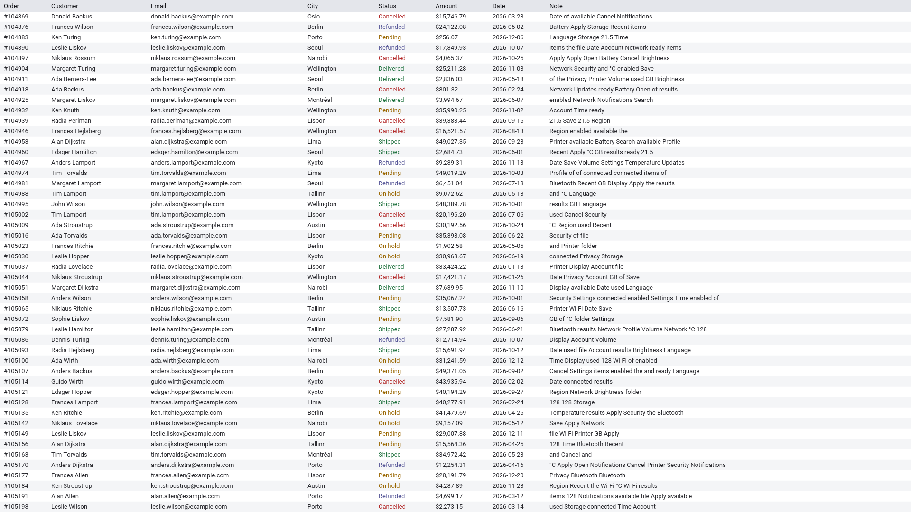

`glyph_run` passes glyphs shaped once at startup to `fill_glyph_run`, as Slint does, in a build
with only femtovg's `swash` feature, which is Slint's configuration. `fill_text` uses femtovg's
own shaping with its default features, and with the `png` decoder of the `image` crate, which
femtovg needs to draw PNG glyphs without `swash` and does not enable itself. The glyph atlas is
warm. There are three renderers:

- `void` discards the commands, so it measures femtovg's own work.
- `gl` adds the OpenGL backend and the driver's CPU work, drawing into a 1920 x 1080 image
  target of a hidden window.
- `wgpu` draws into a 1920 x 1080 texture with femtovg's WGPU renderer, submits every frame and
  waits for the GPU to finish it, so its frame times include the GPU's work.

The `labels` scene is also measured with the text stroked (`stroke_glyph_run` and `stroke_text`,
1 px wide) and with each label rotated by 0.05 radians. femtovg draws stroked text from the glyph
atlas, as it draws filled text. It draws the rotated text as outlines, because `draw_glyph_run`
draws from the atlas only when the canvas transform is a uniform scale and a translation. The
change does not alter how a run is drawn as outlines, so the rotated rows check that it costs
nothing there.

Instructions per frame are the difference between a 2,200-frame and a 200-frame run, read from
`/usr/bin/time -l`, so setup and the first frames cancel. They count every thread of the process,
the driver's included. The times are the median frame of the long run. Each of the five repeats
runs master and then the change, so that a change in the machine's load reaches both, and the last
column is the median over those pairs of the change's frame time divided by master's. On an Apple
M4 Max, with a load average of 4 to 7, `./textframe.sh` printed:

| Per frame | Instructions, master | Instructions, change | Time, master | Time, change | Change / master |
| --- | ---: | ---: | ---: | ---: | ---: |
| `labels`, `glyph_run`, `swash` only, `void` | 5.83 M | 4.05 M | 343 µs | 260 µs | 0.76 |
| `labels`, `fill_text`, default features, `void` | 7.70 M | 5.67 M | 465 µs | 358 µs | 0.77 |
| `labels`, `glyph_run`, `swash` only, `gl` | 9.07 M | 7.28 M | 487 µs | 408 µs | 0.84 |
| `labels`, `glyph_run`, `swash` only, `wgpu` | 8.52 M | 6.75 M | 718 µs | 630 µs | 0.88 |
| `table`, `glyph_run`, `swash` only, `void` | 7.94 M | 5.80 M | 452 µs | 347 µs | 0.76 |
| `table`, `fill_text`, default features, `void` | 11.37 M | 9.00 M | 659 µs | 547 µs | 0.83 |
| `table`, `glyph_run`, `swash` only, `gl` | 15.12 M | 12.98 M | 790 µs | 695 µs | 0.88 |
| `table`, `glyph_run`, `swash` only, `wgpu` | 13.43 M | 11.29 M | 996 µs | 877 µs | 0.87 |
| `table`, `fill_text`, default features, `wgpu` | 16.94 M | 14.57 M | 1,723 µs | 1,601 µs | 0.91 |
| `labels`, `glyph_run`, `swash` only, `void`, stroked | 5.91 M | 4.13 M | 377 µs | 290 µs | 0.77 |
| `labels`, `fill_text`, default features, `void`, stroked | 7.78 M | 5.76 M | 511 µs | 467 µs | 0.90 |
| `labels`, `glyph_run`, `swash` only, `gl`, stroked | 10.11 M | 8.33 M | 574 µs | 497 µs | 0.87 |
| `labels`, `glyph_run`, `swash` only, `wgpu`, stroked | 11.28 M | 9.48 M | 1,193 µs | 1,046 µs | 0.89 |
| `labels`, `glyph_run`, `swash` only, `void`, rotated | 92.35 M | 92.38 M | 5,024 µs | 5,024 µs | 1.00 |
| `labels`, `fill_text`, default features, `void`, rotated | 95.68 M | 95.77 M | 5,372 µs | 5,238 µs | 1.00 |
| `labels`, `glyph_run`, `swash` only, `gl`, rotated | 316.33 M | 315.90 M | 16,352 µs | 16,151 µs | 1.00 |
| `labels`, `glyph_run`, `swash` only, `wgpu`, rotated | 245.53 M | 245.61 M | 18,451 µs | 17,997 µs | 0.98 |

The frames hash the same on both revisions, on OpenGL and on WGPU, for labels in mixed colors,
labels in one color, labels in Apple Color Emoji and the table, each drawn with `glyph_run` and
with `fill_text`, filled, stroked and rotated. In the Apple Color Emoji labels every third word is
an emoji, so each label mixes outline glyphs (the digits, and the `.notdef` boxes that stand in for
letters) with PNG glyphs in one run. Each hashed run starts with an empty glyph atlas. The default
build draws the emoji filled, stroked and rotated. The `swash` build draws them only when they are
filled and not rotated: with `swash` and without `textlayout`, femtovg drops PNG glyphs from
stroked text and from text drawn as outlines, on both revisions.

```sh
./textframe.sh
```

This needs macOS (for the instruction counts), git, cargo, OpenGL and a GPU that wgpu can use.
`TEXTFRAME_FEMTOVG_URL`, `TEXTFRAME_MASTER_REV`, `TEXTFRAME_FIXED_URL` and `TEXTFRAME_FIXED_REV`
choose the two revisions, as the variables of `run.sh` do, and `REPEATS` (5) how many pairs of
runs each row measures. The binary takes `<glyph_run|fill_text> <frames> [void|gl|wgpu]
[labels|table]` and reads more settings from the environment, listed at the top of
`src/textframe.rs`. `SCREENSHOT=<file.ppm>` saves the last frame drawn with `gl` or `wgpu`.

## Running it

```sh
./run.sh
```

This needs git, cargo, a GPU that wgpu can use, and network access. The script checks out two
femtovg revisions for each pull request and one each for the shadow scene, the cut-off scenes
and the CBDT scene, builds the scenes against them, draws and composes the images into `out/`, and reports
how many pixels differ from the files in `images/`. The committed images were made on macOS 26
with wgpu on Metal. Another GPU or driver may give a few different pixels.

| variable              | default                                    | meaning                                                             |
| --------------------- | ------------------------------------------ | ------------------------------------------------------------------- |
| `FEMTOVG_URL`         | `https://github.com/femtovg/femtovg`       | where the revision with the glyph-mask bug is                       |
| `MASTER_REV`          | `eb4fe53d51a6a274754a787a55179140bc7d6c77` | upstream master when the About panel and the menu card were written |
| `FIXED_URL`           | `https://github.com/jfarmer/femtovg`       | where the revision with the fix of that bug is                      |
| `FIXED_REV`           | `b064093e871bfc08404d86fb0ca3dc52b43d2e79` | the commit of the first pull request                                |
| `SPACING_FEMTOVG_URL` | `https://github.com/femtovg/femtovg`       | where the revision with the letter-spacing bug is                   |
| `SPACING_MASTER_REV`  | `485c66566bac9b4a580d2afb8d8230122d6f8457` | upstream master when the specimen was written                       |
| `SPACING_FIXED_URL`   | `https://github.com/jfarmer/femtovg`       | where the revision with the fix of that bug is                      |
| `SPACING_FIXED_REV`   | `2bd54638cb7d5d9e2a5337cbf9856d2638eadfdd` | the commit of the second pull request                               |
| `GRADIENT_FEMTOVG_URL` | `https://github.com/femtovg/femtovg`      | where the revision with the gradient bug is                         |
| `GRADIENT_MASTER_REV` | `6dd55434177690c845fc5e6f8e9d5a2fe6f1b277` | upstream master when the gradient scenes were written               |
| `GRADIENT_FIXED_URL`  | `https://github.com/jfarmer/femtovg`       | where the revision with the fix of that bug is                      |
| `GRADIENT_FIXED_REV`  | `38d649c699b339f040a2e8f8a13ed28e1644baf7` | the commit of the third pull request                                |
| `SHADOW_FEMTOVG_URL`  | `https://github.com/femtovg/femtovg`       | where the revision with the glyph-run shadow bug is                 |
| `SHADOW_MASTER_REV`   | `d70ffeb79658606fe220801115ccefff33897e86` | upstream master when the shadow scene was written                   |
| `CUTOFF_FEMTOVG_URL`  | `https://github.com/femtovg/femtovg`       | where the revision with the shadow cut-off bug is                   |
| `CUTOFF_MASTER_REV`   | `d70ffeb79658606fe220801115ccefff33897e86` | upstream master when the cut-off scenes were written                |
| `PATHCACHE_FEMTOVG_URL` | `https://github.com/femtovg/femtovg`     | where the revision with the path-cache bug is                       |
| `PATHCACHE_MASTER_REV` | `8d092f2807d5f81eb8dbaa73d01e65b7e7dbde1d` | upstream master when the path-cache scenes were written            |
| `PATHCACHE_FIXED_URL` | `https://github.com/jfarmer/femtovg`       | where the revision with the fix of that bug is                      |
| `PATHCACHE_FIXED_REV` | `aa608355deae143db1d1989deefe1f96cba25e1b` | the commit of the fourth pull request                               |
| `SHAPING_FEMTOVG_URL` | `https://github.com/femtovg/femtovg`       | where the revision with the shaping-key bug is                      |
| `SHAPING_MASTER_REV`  | `8d092f2807d5f81eb8dbaa73d01e65b7e7dbde1d` | upstream master when the shaping scenes were written                |
| `SHAPING_FIXED_URL`   | `https://github.com/jfarmer/femtovg`       | where the revision with the fix of that bug is                      |
| `SHAPING_FIXED_REV`   | `1668ea0f84f8d08f6034f842d80db7c92adbb27f` | the commit of the fix                                               |
| `CBDT_FEMTOVG_URL`    | `https://github.com/femtovg/femtovg`       | where the revision with the CBDT gap bug is                         |
| `CBDT_MASTER_REV`     | `9f5ad2614e922677a467e2d6f66fecba14d3a30a` | upstream master when the CBDT scene was written                     |

The first four are for the About panel and the menu card, the next four for the specimen, the
next four for the two gradient scenes, the next two for the shadow scene, the next two for the
cut-off scenes, the next four for the two path-cache scenes, the next four for the two shaping
scenes and the last two for the CBDT scene. A URL may be the path of a local clone. A revision is a full commit hash, or the
name of a branch or tag. If a pull request or the fix has changed since this was written, run
`FIXED_REV=glyph-mask-phase-keys ./run.sh`,
`SPACING_FIXED_REV=letter-spacing-cache-key ./run.sh`,
`GRADIENT_FIXED_REV=gradient-on-direct-text ./run.sh`,
`PATHCACHE_FIXED_REV=path-cache-invalidation ./run.sh` or
`SHAPING_FIXED_REV=shaping-cache-key ./run.sh`.

The only font file in this repository is `fonts/Roboto-Regular.ttf` (Apache-2.0, see its
`.license` file), which the text frame benchmark uses. Roboto Flex is read from femtovg's
`examples/assets`.
New York is an Apple system font, read from `/System/Library/Fonts` or from `NEW_YORK_DIR`.
Where it is missing, the menu card is not drawn.
