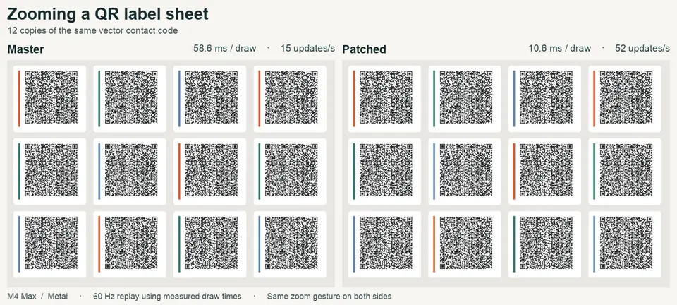
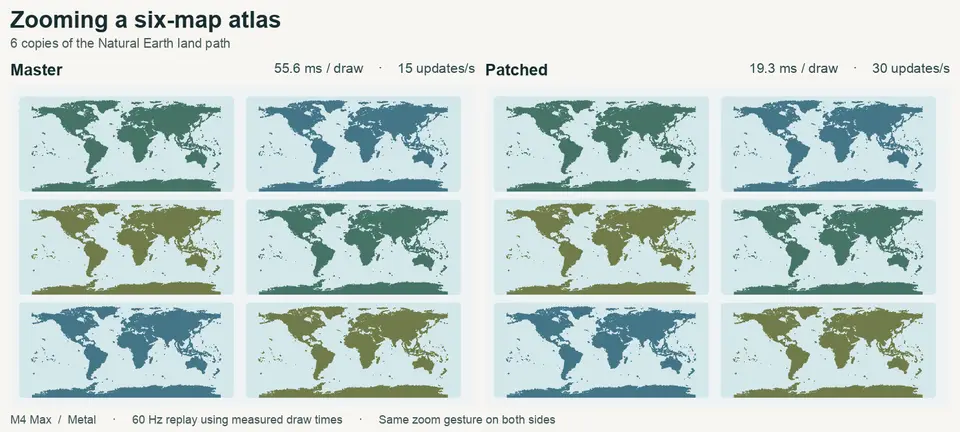

# Compound-path zoom comparisons

Master is on the left and the patch is on the right. Each animation loops one zoom gesture. Both panes receive the same input, with each measured Metal draw time rounded up to the next 60 Hz display refresh. The update rates are measured over the ten-second source replay.

**QR label sheet** · Twelve copies of one vector QR code. [Full-size MP4](../images/contour-motion/labels.mp4)



**Six-map atlas** · Six copies of Natural Earth's public-domain 1:50m land polygons. [Full-size MP4](../images/contour-motion/atlas.mp4)



## Reproduce the published clips

On macOS, install Python 3, Pillow and FFmpeg (with libx264). The captions use the system Arial fonts. From the repository root, pass the release svg-harness built from femtovg master revision `c56d160eaac885ad5705a65529d6788e6accf723`:

```sh
python3 contour-motion/capture.py /path/to/master/svg-harness
python3 contour-motion/movies.py
```

The first command renders 300 zoom positions per scene to `out/contour-motion`. The second encodes the MP4s and animated WebPs in `images/contour-motion` using the checked-in M4 Max timings. Replaying those traces only requires master because both measured builds produced identical pixels at every position.

## Measure another build

```sh
python3 contour-motion/capture.py /path/to/master/svg-harness --patched /path/to/patched/svg-harness
python3 contour-motion/movies.py --measured-on 'Your GPU / backend' --output out/new-clips
```

The published candidate used femtovg revision `cbb5681eb5a0c69d748e07f7315dda37bf361b22`. Both builds use the same SVG harness. For each scene its soak command draws two passes on one persistent canvas; the second pass supplies the timings. The ladder command captures the images separately so PNG export is outside the timed draw. Fresh comparisons check every zoom position for pixel equality before composing the two panes.
